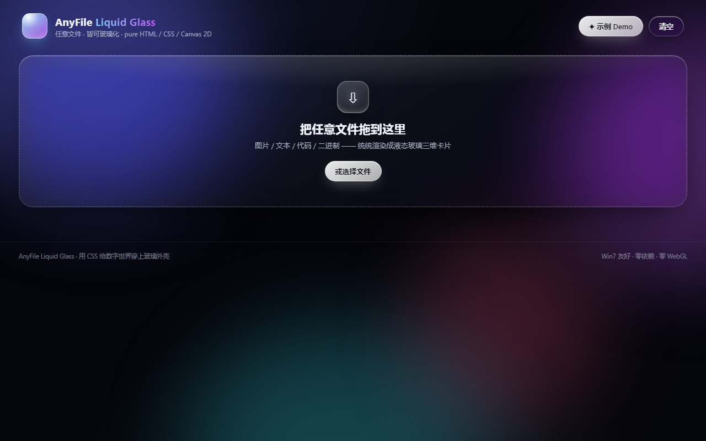
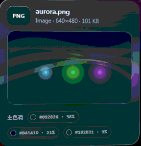
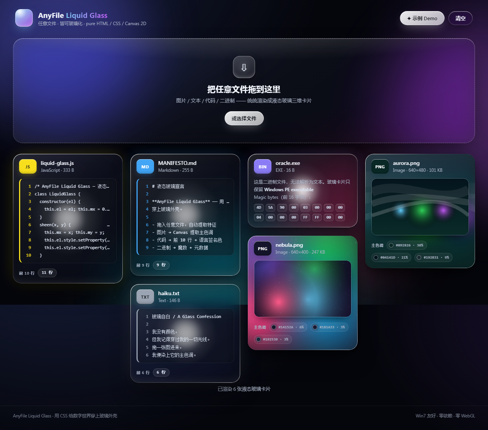

# AnyFile Liquid Glass

> **AnyFile Liquid Glass：用 CSS 给数字世界穿上玻璃外壳。**
> *AnyFile Liquid Glass: slipping a glass shell over the digital world with pure CSS.*

任意文件 —— 图片、文本、Markdown、代码，甚至无意义的二进制文件 ——
拖进来，自动提取特征，渲染成一张 **visionOS 质感的液态玻璃三维卡片**。

Any file — an image, a text file, Markdown, code, even a meaningless binary blob —
gets dropped in, profiled, and rendered as a **visionOS-grade liquid-glass 3D card**.



---

## ✨ 特性 / Features

| 模块 Module | 能力 Capability |
| --- | --- |
| `lg_file_oracle` | 任意文件特征嗅探：图片用 **Canvas 2D `getImageData`** 提取主色调；文本/代码提取前 10 行核心字符；二进制提取文件名、大小与魔数（magic bytes） |
| `lg_render_card` | 液态玻璃卡片渲染：`backdrop-filter` 高强度毛玻璃 + `mask-image` 1px 白色发光内描边 + 多重 `box-shadow` 模拟厚度；纯 JS `mousemove` 驱动 radial-gradient **球形高光反射点**与 perspective 三维倾斜 |
| `lg_drag_drop_ui` | 苹果风格拖拽大厅：`cubic-bezier(.34, 1.56, .64, 1)` 柔性弹跳展开动画，多文件同时拖入自动 **瀑布流排布** |

- 🪶 **零依赖、零 WebGL**：纯 HTML / CSS / 原生 JS + Canvas 2D
- 🪟 **Win7 / 8G 内存友好**：不使用任何重型图形库或原生 C++ 模块
- 🎨 **图片主色调提取**：36×36 缩放采样、4-bit 分桶、饱和度加权
- 🌈 **语言签名色**：JS 黄、Python 蓝、Markdown 蓝……每种文件类型有自己的标志色
- 🖱️ **高光跟随 + 3D 倾斜**：鼠标移动时玻璃表面的反射光点实时跟随、卡片随视角倾斜
- 📱 **响应式瀑布流**：`columns: 4 280px` 自适应列数
- ⌨️ **命令行版**：`cli/oracle.js` 零依赖 Node 脚本，终端直接输出特征 JSON

---

## 🚀 快速开始 / Quick Start

### 浏览器版（双击即用）

1. 用任意现代浏览器打开 `index.html`
2. 把任意文件拖进大厅（支持多文件），或点击「示例 Demo」
3. 键盘党也可以访问 `index.html#demo` 直开示例

> 无需构建步骤、无需服务器 —— 这是一个纯静态页面。
> No build step, no server — it is a fully static page.

### 命令行版

```bash
node cli/oracle.js README.md index.html my-photo.jpg
```

输出每个文件的 JSON 特征画像（类型判断、前 10 行、魔数、大小）：

```json
{
  "name": "README.md",
  "category": "text",
  "lang": "Markdown",
  "accent": "#42a5f5",
  "lines": ["# AnyFile Liquid Glass", "", ...],
  "prettySize": "3.2 KB"
}
```

---

## 🧪 效果预览 / Preview



演示动画：鼠标在极光图片卡上做圆周运动 —— 玻璃表面的**球形高光反射点**实时跟随，
卡片随鼠标位置做 perspective 三维倾斜。



上图为内置示例一次性渲染的 6 张卡片：两张图片卡（Canvas 程序生成的星云与极光，附主色调色板）、
代码卡（等宽字体 + 行号 + JS 标志黄）、Markdown 卡、纯文本卡、二进制卡（魔数 + 前 16 字节十六进制）。

---

## 🏗️ 架构 / Architecture

```
┌──────────────┐     ┌──────────────────┐     ┌────────────────┐
│  用户拖文件   │ ──▶ │ lg_file_oracle   │ ──▶ │ lg_render_card │
│  drop a file │     │ 嗅探 + 特征提取  │     │ 液态玻璃渲染   │
└──────────────┘     └──────────────────┘     └───────┬────────┘
                                                      │
                                              ┌───────▼────────┐
                                              │ lg_drag_drop_ui│
                                              │ 瀑布流 + 弹跳  │
                                              └────────────────┘
```

```
dsh-anyfile-liquid-glass/
├── index.html                  # 拖拽交互大厅（苹果风格）
├── css/style.css               # 液态玻璃核心样式
├── js/
│   ├── lg_file_oracle.js       # 任意文件特征嗅探
│   ├── lg_render_card.js       # 液态玻璃卡片渲染
│   └── main.js                 # 拖拽编排 / Demo 生成
├── cli/oracle.js               # Node 命令行版嗅探（零依赖）
└── assets/
    ├── demo.gif                # 高光跟随演示动图
    ├── screenshot-landing.png  # 主界面截图
    ├── screenshot-gallery.png  # 渲染画廊截图
    ├── make-gif.js             # 演示动图构建：PNG 截帧 → 216 色量化 → GIF89a/LZW
    └── verify-gif.js           # GIF 往返自检（独立 LZW 解码器逐像素比对）
```

> `assets/` 下的两个脚本是演示动图的构建链：`make-gif.js` 用纯 Node（zlib 解 PNG +
> 216 色量化 + 手写 LZW 编码器）把浏览器截取的帧合成 `demo.gif`；`verify-gif.js`
> 用独立实现的 GIF 解码器对产物做逐像素往返自检（已通过，并成功解码过系统内
> 真实 GIF 以校验时序）。零依赖，无 ffmpeg。


### 液态玻璃的配方 / The glass recipe

```css
.liquid-glass {
  /* 高强度毛玻璃 */
  backdrop-filter: blur(22px) saturate(1.7) brightness(1.06);
  /* 厚度感 = 多重阴影 */
  box-shadow:
    inset 0 1px 0 rgba(255,255,255,.55),   /* 1px 白色发光内描边 */
    0 10px 20px -6px rgba(0,0,0,.45),      /* 近层阴影 */
    0 28px 56px -12px rgba(0,0,0,.55);     /* 悬浮厚度 */
}
.lg-edge { /* mask-image 抠出 1px 渐变光环 */
  -webkit-mask: linear-gradient(#000 0 0) content-box, linear-gradient(#000 0 0);
  -webkit-mask-composite: xor;
}
```

高光跟随：JS 只更新两个 CSS 变量，渲染完全交给合成层 —— Win7 也丝滑。
The sheen tracking only updates two CSS variables; all painting is delegated to
the compositor — buttery even on Windows 7.

```js
frame.addEventListener('mousemove', (e) => {
  const r = frame.getBoundingClientRect();
  glass.style.setProperty('--mx', ((e.clientX - r.left) / r.width * 100) + '%');
  glass.style.setProperty('--my', ((e.clientY - r.top)  / r.height * 100) + '%');
});
```

---

## 🌐 开源 / Open Source

MIT License —— 随便用、随便改、欢迎 PR。
MIT License — use it, fork it, PRs welcome.

### 推送到 GitHub / Push to GitHub

```bash
# 1. 在 GitHub 上新建空仓库（不要勾选 README/LICENSE/.gitignore）
#    Create an empty repo on GitHub first.

# 2. 关联远程并推送 / Wire up the remote and push
cd D:\Code\dsh-anyfile-liquid-glass
git remote add origin https://github.com/<你的用户名>/dsh-anyfile-liquid-glass.git
git branch -M main
git push -u origin main

# SSH 方式 / via SSH
# git remote add origin git@github.com:<你的用户名>/dsh-anyfile-liquid-glass.git
```

---

## 📄 License

MIT © 2026 AnyFile Liquid Glass contributors
